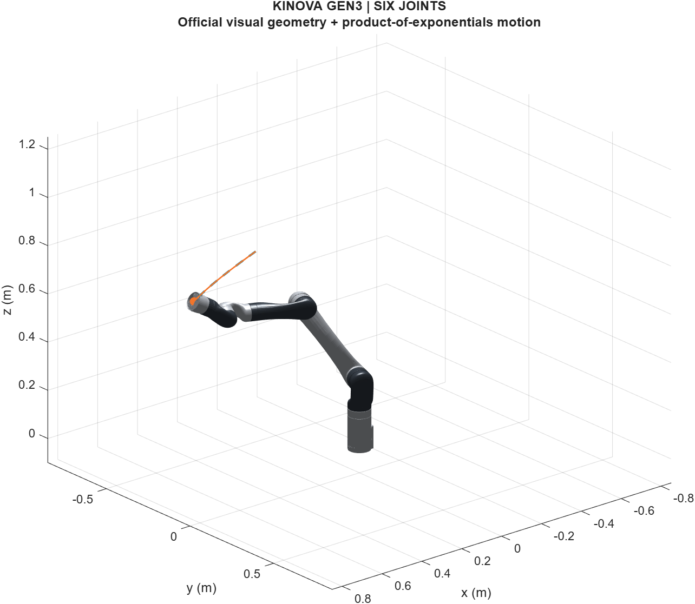

# Kinova Gen3 Geometric Simulator

A standalone MATLAB mechanical model of the **six-joint Kinova Gen3, without the vision module or a gripper**. Kinematics use twists, adjoints and exponential maps on SE(3). Dynamics reuse the optimized spatial Newton-Euler kernels developed for SHAPE.

Version **0.1.0**. MATLAB-only runtime, with source parameters, validation receipts and third-party licenses included. See [release history](CHANGELOG.md).



## Run

In MATLAB, open this repository and run:

```matlab
setup_kinova;
summary = run_kinova_demo();
```

The demo validates the model, follows a smooth joint trajectory, checks the mechanical energy balance and halves the plant integration step to compare results. It saves `results/demo.mat`, readable JSON metrics and PNG figures. Execution is offline and requires **base MATLAB**, with no Simulink, Robotics System Toolbox, generated MEX files or Python. Tested on R2026a; the plotting and JSON APIs require R2021a or later, but older releases have not been tested.

For interactive playback:

```matlab
addpath('examples');
s = load('results/demo.mat');
animate_kinova(s.log, s.m);
```

## Use the model

```matlab
m = kinova.model();
q = [0; .35; -.7; 0; .35; 0];
dq = zeros(6,1);

T = kinova.fk(q,m);                        % flange pose in SE(3)
J = kinova.jacobian(q,m,'body');            % [angular; linear] twist Jacobian
[M,b] = kinova.dynamics(q,dq,m);            % M*qdd + b = tau
tau = kinova.inverse_dynamics(q,dq,zeros(6,1),m);
qdd = kinova.forward_dynamics(q,dq,tau,m);
[H,K,V] = kinova.energy(q,dq,m);
```

Options keep the mechanical scope explicit:

```matlab
m_links = kinova.model(struct('actuator_profile','rigid_links'));
m_custom = kinova.model(struct('actuator_profile','custom', ...
    'custom_apparent_inertia',[.09;.09;.09;.056;.056;.056]));
m_shape = kinova.model(struct('friction_profile','shape_blend'));
```

The custom values above are an API example, not a separate parameter identification. Model objects are immutable by convention: construct a new model to change parameters, so poses, twists and inertia tensors remain consistent.

`kinova.config()` holds controller and integration settings separately from robot parameters. `kinova.simulate(m,c)` also accepts optional user functions for joint effort, actuator effectiveness and an external flange wrench. The controller uses joint positions as flat outputs and inverse dynamics to map a commanded acceleration to torque. The example is computed-torque feedback, not a full MPC solver.

## Mechanical scope and parameter sources

The equation is

```text
[M_links(q) + J_apparent] qdd + c_links(q,qd) + g_links(q) + f(qd)
    = tau_applied + J_body(q)' F_environment.
```

- **Rigid links:** official Kinova six-DoF, no-vision URDF, pinned to revision `5f66bbd1be84cb699020621dc7c8f3df01394960`. Literal poses, masses, center-of-mass offsets and inertia tensors are retained. `Mlist` contains consecutive relative transforms; absolute home poses are stored separately for screw-axis construction.
- **Apparent actuator inertia:** Cholet's commercial motor/reducer approximations, transferred by the Medium/Small grouping of the six-joint arm. The reducer inertia is treated as already referred to the output: `J_apparent = N^2*J_motor + J_reducer_output`. This gives **0.0930079 kg m²** on joints 1-3 and **0.0560033 kg m²** on joints 4-6. It is a constant diagonal mechanical approximation, not a complete rotor-body or electrical model.
- **Friction coefficients:** Muraccioli et al., RSS 2025, Sec. VII-A, eq. (12). Their seven-joint robot identification gives coefficients by actuator size; this model transfers them to three large and three small joints. Default friction is smooth viscous/Coulomb effort: `Fv.*qd + Fc.*tanh(50*qd)`. `shape_blend` preserves the additional low-speed blending used by the earlier SHAPE plant. Neither smooth option reproduces set-valued static sticking.
- **Effort:** total generalized torque on the joint side. Gravity is included in the plant and compensation is generated by the controller. No undocumented electrical parameters or extra efficiency factor are inserted into stored kinetic energy. Mechanical losses are represented by friction.
- **Limits:** manufacturer effort and velocity limits. Continuous joints are unbounded in position; finite joint limits retain their lower and upper values. Torque saturation is applied to the command. Position and velocity limits are monitored, not enforced by an impact/contact or barrier model.

This is a physically grounded mechanical simulation with approximate actuator parameters. The numerical tests validate mathematical consistency and implementation; they do **not** establish experimental accuracy for a particular physical arm. It is a new simulation model and does not reproduce the frozen SHAPE manuscript campaign.

See [Model and conventions](docs/MODEL.md), [Validation](docs/VALIDATION.md), [Source records](sources/manifest.json) and [Third-party notices](THIRD_PARTY_NOTICES.md).

## Reused optimizations

Three kernels are copied byte-for-byte from SHAPE:

1. Shared kinematics with model-constant hoisting and an exact joint-state cache.
2. RNEA with direct construction of the Lie-bracket matrix `ad(V)`.
3. Mass-matrix columns with zero-state recursion that skips structurally zero propagation.

They receive the corrected relative-frame model here. Correctness is checked against the stock Modern Robotics routines and an independent COM-Jacobian/Lagrange construction. Run `addpath('tools'); benchmark_kinova` for a local timing comparison. Timing is machine-specific, warmed serial CPU performance; it is not a real-time guarantee.

The scalar quintic phase functions from Flatness-MPC are also preserved unchanged. All copies, source paths and SHA-256 hashes are recorded.

## Sources

- [Kinova's official six-joint URDF](https://github.com/Kinovarobotics/ros_kortex/blob/5f66bbd1be84cb699020621dc7c8f3df01394960/kortex_description/arms/gen3/6dof/urdf/GEN3-6DOF_NO-VISION_URDF_ARM_V01.urdf).
- A. Cholet, *Development of a Versatile Exploration and Optimization Tool for the Conceptual Design of Serial Robot Manipulators*, master's thesis, Polytechnique Montréal, 2025: [institutional record](https://publications.polymtl.ca/66945/). See Sec. 3.1.3, Sec. 4.1 and Tables A.1/B.1. The actuators were selected as commercial substitutes for conceptual design.
- B. Muraccioli, M. Celerier, M. Benallegue and G. Venture, *Demonstrating a Control Framework for Physical Human-Robot Interaction Toward Industrial Applications*, RSS 2025: [published paper](https://www.roboticsproceedings.org/rss21/p084.html), DOI `10.15607/RSS.2025.XXI.084`.
- K. M. Lynch and F. C. Park, *Modern Robotics: Mechanics, Planning, and Control*, Cambridge University Press, 2017: [Chapter 8.9](https://modernrobotics.northwestern.edu/nu-gm-book-resource/8-9-actuation-gearing-and-friction/) and [Modern Robotics library](https://github.com/NxRLab/ModernRobotics).

## License

The new code is MIT-licensed, as are the author-contributed kernels reused with permission. Modern Robotics retains its own MIT notice. Kinova URDF and visual meshes retain their BSD-style source license and attribution. See [LICENSE](LICENSE) and [THIRD_PARTY_NOTICES.md](THIRD_PARTY_NOTICES.md).
