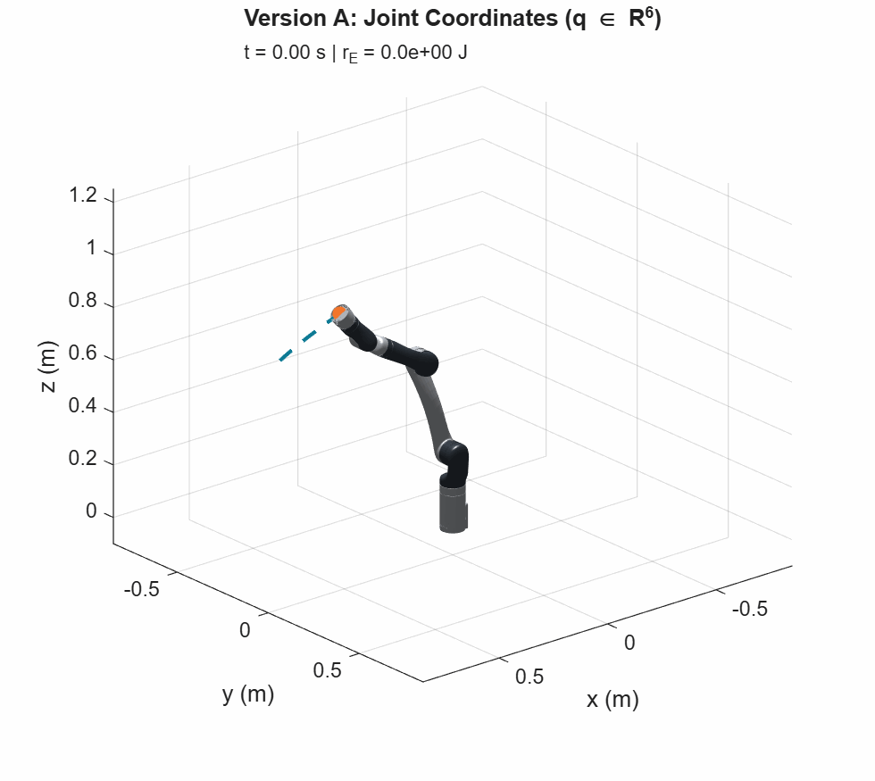
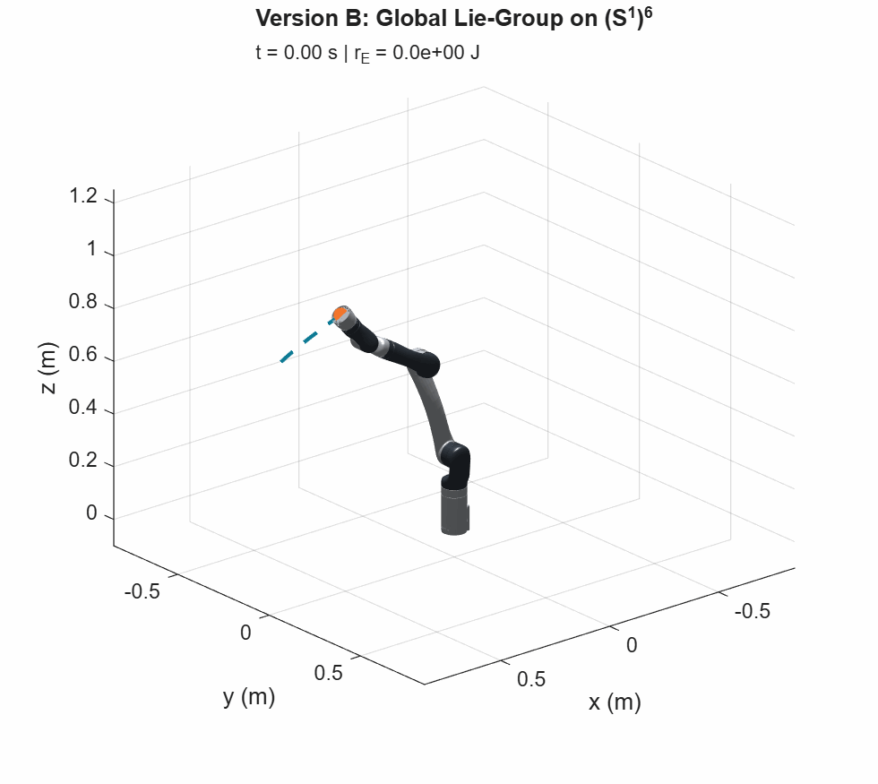
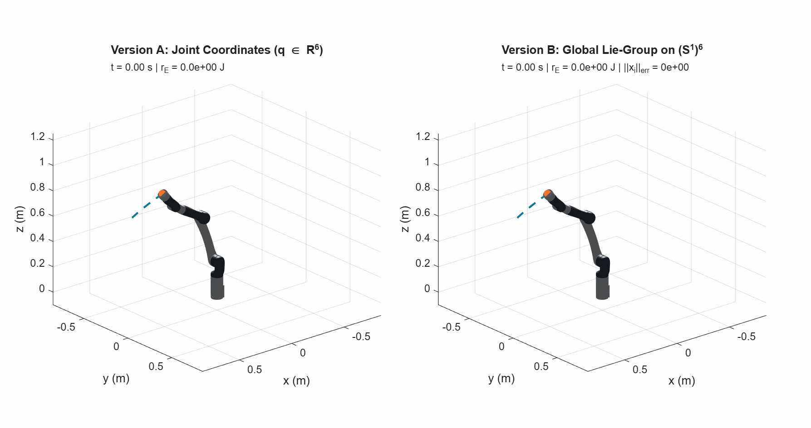
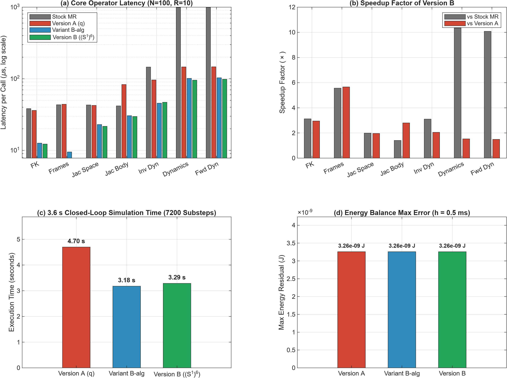

# Kinova Gen3 — Two Geometric Dynamics Formulations

A standalone, reproducible MATLAB mechanical simulator of the **six-degree-of-freedom Kinova Gen3 (without vision module or gripper)**, implementing and comparing two distinct geometric dynamics representations of the same physical robot:
- **Version A — Original Joint-Coordinate Geometric Dynamics (`+kinova/`):** Joint coordinates $q \in \mathbb{R}^6$, spatial Product of Exponentials (PoE) in $SE(3)$, twists, adjoints, and SHAPE-optimized spatial recursive Newton–Euler algorithms (RNEA).
- **Version B — Global Lie-Group Dynamics on $(S^1)^6$ (`+kinova_s1/`):** Configuration on the 6-torus unit manifold $X \in (S^1)^6 \subset \mathbb{R}^{2\times 6}$, purely algebraic screw exponentials (Theorem 2.1), hoisted adjoint homomorphism factorization, Abelian Munthe–Kaas 4-stage Lie-group RK4 integration, and rigorous handling of mixed topology: continuous joints $\{1, 4, 6\}$ (unbounded $\mathbb{R}$, fiber winding $w \in \mathbb{Z}$) vs. bounded revolute joints $\{2, 3, 5\}$ (admissible closed arcs $\mathcal{A}_i \subsetneq S^1$).

Both formulations share identical physical parameters from the official Kinova URDF, identical actuator apparent inertia ($J_{\text{app}}$, Cholet 2025), and identical smooth friction models (Muraccioli et al., RSS 2025). Neither representation alters the physics or physical limits of the manipulator.

---

## 3D Visual Comparison: Both Formulations in Motion

| Version A — Original Joint Coordinates ($q \in \mathbb{R}^6$) | Version B — Global Lie-Group on $(S^1)^6$ |
|:---:|:---:|
|  |  |
| Spatial PoE $\exp([\mathcal{S}_i] q_i)$, $\mathbb{R}^6$ angles, SHAPE RNEA | Global embedding $X \in (S^1)^6$, algebraic $\exp([\mathcal{S}_i], x_i)$, Lie RK4-MK |

### Combined Side-by-Side Simulation


3.6 s closed-loop quintic trajectory with computed torque control: desired trajectory (dashed teal) and executed end-effector path (orange for Version A, green for Version B). Trajectories coincide to within $0.48\,\mu\text{m}$ spatial tracking difference and $< 10^{-14}\text{ rad}$ at the final state.

---

## Mathematical Formulations

| Mathematical Aspect | Version A (`+kinova/`) — Euclidean PoE | Version B (`+kinova_s1/`) — Global $(S^1)^6$ Lie-Group |
|:---|:---|:---|
| **Configuration Space** | $q = [q_1, \dots, q_6]^\top \in \mathbb{R}^6$ | $X = [x_1, \dots, x_6] \in (S^1)^6 \subset \mathbb{R}^{2\times 6}$, with $x_i = [c_i, s_i]^\top$ and $x_i^\top x_i = 1$ |
| **Velocity State** | $\dot{q} \in \mathbb{R}^6$ | Left-trivialized angular velocity $\omega \in \mathbb{R}^6$, with $\dot{x}_i = \omega_i J x_i$ ([Eq. 1](#core-geometric-equations-on-s16)) |
| **Tangent Space** | $T \mathbb{R}^6 \cong \mathbb{R}^6 \times \mathbb{R}^6$ | $T(S^1)^6 \cong (S^1)^6 \times \mathbb{R}^6$ (Global left trivialization) |
| **Space Screw Exponential** | $\exp([\mathcal{S}_i] q_i) \in SE(3)$ via series / Rodrigues (`MatrixExp6`) | $\exp([\mathcal{S}_i], x_i) = I_4 + s_i [\mathcal{S}_i] + (1 - c_i) [\mathcal{S}_i]^2$ ([Theorem 2.1](#core-geometric-equations-on-s16): purely algebraic) |
| **Link Transformations** | $T_{0,i} = T_{0,i-1} M_i \exp([\mathcal{A}_i] q_i)$, with $\mathcal{A}_i = [0, 0, 1, 0, 0, 0]^\top$ | $T_{0,i} = T_{0,i-1} M_i T_z(x_i)$, with $T_z(x_i) = \mathrm{diag}(R_z(x_i), 1)$ (zero transcendental calls) |
| **Inter-Link Adjoints (RNEA)** | Recursive PoE adjoints via `Adjoint` with `NearZero` threshold | Hoisted matrix-free product ([Eq. 3](#core-geometric-equations-on-s16)) without conditional branching |
| **Continuous Joints ($\{1, 4, 6\}$)** | Unbounded coordinates $q_i \in (-\infty, +\infty)$ | Full circle $S^1$, with exact fiber winding offset $w_i \in \mathbb{Z}$ in covering space ([Eq. 5](#core-geometric-equations-on-s16)) |
| **Bounded Revolute ($\{2, 3, 5\}$)** | Symmetric intervals $[q_{\min,i}, q_{\max,i}]$ | Exact algebraic arc condition $u_i^\top \hat{x}_i \ge \cos h_i$ and centered chart $\delta_i \in [-h_i, h_i]$ ([Eq. 4](#core-geometric-equations-on-s16)) |
| **Algebraic Character** | Involves trigonometric calls (`cos`, `sin`) at every joint | **Polynomial in $(c_i, s_i)$** for FK, Jacobians, and RNEA; **rational in $(c_i, s_i)$** for FD |
| **Equations of Motion** | $M(q)\ddot{q} + c(q, \dot{q}) + g(q) + f(\dot{q}) = \tau$ | $M(X)\dot{\omega} + c(X, \omega) + g(X) + f(\omega) = \tau$ (Lee et al. 2018, Eq. 4.12) |
| **Numerical Integration** | Classical 4-stage Runge–Kutta (RK4) in $\mathbb{R}^{12}$ | Abelian Munthe–Kaas 4-stage Lie-group RK4 (RK4-MK) with machine-precision norm preservation |
| **Large-Displacement Error** | Joint coordinate difference $q_{\text{ref}} - q \in \mathbb{R}^6$ | Admissible-arc displacement $\Delta q_{\text{box}}$ via `box_diff(X_ref, X, m, w)` avoiding forbidden stop sectors |

---

### Core Geometric Equations on $(S^1)^6$

#### 1. Configuration and Left-Trivialized Velocity Kinematics

$$
x_i = \begin{bmatrix} c_i \\ s_i \end{bmatrix} \in S^1 \subset \mathbb{R}^2, \qquad \dot{x}_i = \omega_i J x_i, \qquad J = \begin{bmatrix} 0 & -1 \\ 1 & 0 \end{bmatrix}
$$

#### 2. Purely Algebraic Space Screw Exponential (Theorem 2.1)

For a unit-axis revolute screw $\mathcal{S}_i = [\hat{\omega}_i; v_i]$ with $\|\hat{\omega}_i\|_2 = 1$ and zero helical pitch ($\hat{\omega}_i^\top v_i = 0$), the $SE(3)$ exponential depends purely algebraically on $x_i = [c_i, s_i]^\top \in S^1$:

$$
\exp([\mathcal{S}_i], x_i) = I_4 + s_i [\mathcal{S}_i] + (1 - c_i) [\mathcal{S}_i]^2 = \begin{bmatrix} I_3 + s_i [\hat{\omega}_i]_\times + (1-c_i)[\hat{\omega}_i]_\times^2 & s_i v_i + (1-c_i)[\hat{\omega}_i]_\times v_i \\ 0 & 1 \end{bmatrix}
$$

#### 3. Hoisted Adjoint Homomorphism Factorization in Spatial RNEA

All six nominal Kinova Gen3 joints have local $z$-axis screws $\mathcal{A}_i = [0, 0, 1, 0, 0, 0]^\top$. Precomputing constant inverse link adjoints $B^{(i)} = \mathrm{Ad}_{M_i^{-1}}$ allows evaluating inter-link adjoints without matrix inversions or transcendental calls:

$$
\mathrm{Ad}_{T_{i,i-1}}(x_i) = \mathrm{diag}\left(R_z(x_i)^\top, R_z(x_i)^\top\right) B^{(i)}
$$

#### 4. Algebraic Characterization of Bounded Revolute Joints ($\{2, 3, 5\}$)

Joints 2, 3, and 5 have symmetric physical limits ($m_i = 0$, $u_i = [1, 0]^\top$) with half-spans $h_2 = 2.24$, $h_3 = 2.57$, $h_5 = 2.09\text{ rad} < \pi$. The admissible arc $\mathcal{A}_i \subsetneq S^1$ is characterized algebraically by:

$$
\mathcal{A}_i = \left\{ x_i \in \mathbb{R}^2 \mid x_i^\top x_i = 1, \quad u_i^\top \hat{x}_i \ge \cos h_i \right\}, \qquad \mu_i = h_i - |\delta_i(x_i)| \ge 0
$$

where $\delta_i(x_i) = \operatorname{atan2}(s_i, c_i) \in [-h_i, h_i]$ is the centered arc chart placing the branch cut strictly in the forbidden mechanical stop sector $S^1 \setminus \mathcal{A}_i$.

#### 5. Universal Covering Space and Fiber Winding Contract for Continuous Joints ($\{1, 4, 6\}$)

Joints 1, 4, and 6 have no mechanical stops ($q \in \mathbb{R}$). For continuous trajectory tracking, the discrete fiber of the universal covering projection $\pi: \mathbb{R} \to S^1$ is tracked via the continuous lift $\tilde{q}(t) = q_0 + \int_0^t \omega(\tau)\,d\tau$. The integer fiber offset:

$$
w_i = \operatorname{round}\left(\frac{(q_{r,i} - \tilde{q}_i) - d_{\text{geo},i}(X_r, X)}{2\pi}\right) \in \mathbb{Z}
$$

guarantees zero winding slip even if transient tracking errors exceed $\pi\text{ rad}$ (e.g. under torque saturation).

---

## Performance & Accuracy: Version A vs. Version B

Evaluated on **MATLAB R2026a Update 4** across $N = 100$ independent states ($1,000$ timed evaluations per routine) with CPU warm-up.

All states are sampled strictly inside the **physically admissible operating envelope** of the Kinova Gen3 via bounded uniform position sampling and rejection-truncated normal sampling:
- **Position Limit Utilization:** $0$ violations across all 100 states.
- **Velocity Limit Utilization:** $\max |\dot{q}| / \dot{q}_{\max} = 0.9459 \le 0.95$ ($0$ violations across all 100 states).
- **Torque Limit Utilization:** $\max |\tau| / \tau_{\max} = 0.9277 \le 0.95$ ($0$ violations across all 100 states).

### Compact Benchmark: Two Formulations in Direct Comparison

| Routine / Simulation Metric | Version A (`+kinova/`, PoE) | Version B (`+kinova_s1/`, Lie $(S^1)^6$) | Advantage (B vs. A) | Algorithmic & Geometric Principle |
|:---|:---:|:---:|:---:|:---|
| **Forward Kinematics (`fk`)** | 36.12 µs | **12.25 µs** | **2.95× faster** | Purely algebraic screw exponentials ([Theorem 2.1](#core-geometric-equations-on-s16)) |
| **Link Frames (`frames`)** | 44.08 µs | **7.79 µs** | **5.66× faster** | Direct $R_z(x_i)$ planar rotation without trigonometric calls |
| **Space Jacobian ($J_s$)** | 42.49 µs | **21.66 µs** | **1.96× faster** | Algebraic screw transformations on $(S^1)^6$ |
| **Body Jacobian ($J_b$)** | 83.10 µs | **29.71 µs** | **2.80× faster** | Homomorphism-factorized body adjoint propagation |
| **Inverse Dynamics (`id`, RNEA)** | 96.28 µs | **46.97 µs** | **2.05× faster** | Hoisted constant link adjoints $B^{(i)} = \mathrm{Ad}_{M_i^{-1}}$ ([Eq. 3](#core-geometric-equations-on-s16)) |
| **Total Dynamics (`dyn`, $M, b$)** | 146.31 µs | **95.66 µs** | **1.53× faster** | Shared recursive kinematics and polynomial mass matrix |
| **Forward Dynamics (`fd`, $\ddot{q}$)** | 146.91 µs | **98.51 µs** | **1.49× faster** | Cholesky-solved joint accelerations from $M(X)$ and $b(X,\omega)$ |
| **Closed-Loop 3.6 s Simulation** | 4.70 s | **3.29 s** | **1.43× faster** | Real-Time Factor (RTF) improves from $0.77\times$ to **$1.10\times$** (7,200 RK4 substeps) |
| **Step-Halved Residual ($h = 0.25\text{ ms}$)** | $2.7271 \times 10^{-9}\text{ J}$ | **$1.6663 \times 10^{-10}\text{ J}$** | **16.37× more accurate** | Version A stagnates at `NearZero`; Version B achieves true $O(h^4)$ |
| **Step-Refined Residual ($h = 0.125\text{ ms}$)** | $2.7271 \times 10^{-9}\text{ J}$ | **$9.3765 \times 10^{-12}\text{ J}$** | **290.8× more accurate** | Version B converges smoothly to machine-precision balance |
| **Final Trajectory Parity** | $< 10^{-14}\text{ rad}$ | 0 (Reference) | **Machine precision** | Trajectories match down to numerical roundoff |
| **Manifold Preservation Error** | N/A (ambient $\mathbb{R}^{12}$) | **$2.22 \times 10^{-16}$** | **1 ulp precision** | Lie-group projection $\|\hat{x}_i\|_2 = 1$ strictly maintained |



### Elimination of `MatrixExp6` / `NearZero` Stagnation

In Version A, the underlying Modern Robotics routine `MatrixExp6` applies the threshold `NearZero` ($\|q_i\| < 10^{-6}\text{ rad}$) to avoid division by zero. Because joints 1, 4, and 6 start at $q_i(0)=0$ in the nominal posture, crossing $10^{-6}\text{ rad}$ at $t = 0.0360\text{ s}$ snaps the rotation matrix to $I_3$, trapping Version A at an irreducible energy error floor of **$2.7271 \times 10^{-9}\text{ J}$**.

Because rotations in Version B are evaluated purely algebraically on $S^1$ without angle divisions or threshold snapping:
- At $h = 0.250\,\text{ms}$, the energy residual drops to **$1.6663 \times 10^{-10}\text{ J}$ ($16.37\times$ lower than Version A)** with reduction ratio $19.55 \approx 2^4 = 16$.
- At $h = 0.125\,\text{ms}$, the energy residual drops to **$9.3765 \times 10^{-12}\text{ J}$ ($290.8\times$ lower than Version A)** with reduction ratio $17.77 \approx 2^4 = 16$.

> [!NOTE]
> **Independent Four-Way Ablation Study (Stock MR vs. Version A vs. Variant B-alg vs. Version B):**  
> To isolate the root causes of the performance gains, an auxiliary ablation benchmark was conducted on identical physical states with two additional control implementations: **Stock Modern Robotics** (canonical textbook baseline) and **Variant B-alg** (which operates in joint coordinates $q \in \mathbb{R}^6$ but invokes the specialized $S^1$ kernels).  
> - **Algorithmic Specialization:** The ablation demonstrates that the majority of the speedup over Version A stems from Theorem 2.1 and the hoisted adjoint factorization $B^{(i)} = \mathrm{Ad}_{M_i^{-1}}$.
> - **Manifold State:** Operating directly on $X \in (S^1)^6$ provides an additional 5.5% to 18.0% speedup in kinematics and dynamics by eliminating runtime `cos(q)` / `sin(q)` evaluations.
> - **Full Report:** See [BENCHMARK_COMPARISON.md](docs/development/BENCHMARK_COMPARISON.md) for full timing distributions, conversion primitive costs, and profiling breakdowns.

---

## Quickstart & Reproducibility

Open this repository in MATLAB and run:

```matlab
setup_kinova;

% 1. Run Version A (Original Euclidean Joint Coordinates)
summary_a = run_kinova_demo();

% 2. Run Version B (Global Lie-Group on (S^1)^6)
summary_b = run_kinova_s1_demo();

% 3. Run Full 4-Way Benchmark Suite
addpath('tools');
bench_results = benchmark_s1_comparison();

% 4. Generate 3D Animated GIFs
generate_kinova_animations();
```

Execution is entirely self-contained and requires **base MATLAB** (R2021a or later, tested on R2026a). No Simulink, Robotics System Toolbox, MEX files, or external toolboxes are required.

### Example Code: Version A vs. Version B

#### Version A: Euclidean Coordinates ($q \in \mathbb{R}^6$)
```matlab
m = kinova.model();
q = [0; 0.35; -0.7; 0; 0.35; 0];
dq = zeros(6, 1);

T = kinova.fk(q, m);                         % End-effector pose in SE(3)
Jb = kinova.jacobian(q, m, 'body');          % Flange-body twist Jacobian
[M, b] = kinova.dynamics(q, dq, m);          % Mass matrix and bias
tau = kinova.inverse_dynamics(q, dq, ddq, m);% RNEA effort
```

#### Version B: Global Manifold ($X \in (S^1)^6$)
```matlab
m = kinova_s1.model();
X = kinova_s1.from_q([0; 0.35; -0.7; 0; 0.35; 0]);  % 2-by-6 configuration matrix
omega = zeros(6, 1);                                % Angular velocity vector

T = kinova_s1.fk(X, m);                      % End-effector pose via Theorem 2.1
Jb = kinova_s1.jacobian(X, m, 'body');       % Flange-body twist Jacobian
[M, b] = kinova_s1.dynamics(X, omega, m);    % Mass matrix and bias
tau = kinova_s1.inverse_dynamics(X, omega, domega, m);
```

---

## Mechanical Scope and Parameter Sources

The mechanical equation of motion is:

$$
\left[ M_{\text{links}}(X) + J_{\text{apparent}} \right] \dot{\omega} + c_{\text{links}}(X, \omega) + g_{\text{links}}(X) + f(\omega) = \tau_{\text{applied}} + J_b(X)^\top F_{\text{environment}}
$$

- **Rigid links:** Official Kinova 6-DoF no-vision URDF, pinned to revision `5f66bbd1be84cb699020621dc7c8f3df01394960`. Masses, center-of-mass vectors, and spatial inertia matrices are retained without modification.
- **Apparent actuator inertia:** Cholet (2025) commercial motor/reducer approximations: **$0.0930079\text{ kg}\cdot\text{m}^2$** on joints 1–3 and **$0.0560033\text{ kg}\cdot\text{m}^2$** on joints 4–6 (`cholet_apparent`, default). Supports `rigid_links` and `custom`.
- **Friction law:** Muraccioli et al. (RSS 2025) smooth viscous/Coulomb model: $f_i(\omega_i) = \beta_{v,i} \omega_i + \beta_{c,i} \tanh(50\omega_i)$.
- **Effort limits:** Total generalized joint torque limits ($\pm 39\text{ N}\cdot\text{m}$ on joints 1–4, $\pm 9\text{ N}\cdot\text{m}$ on joints 5–6) enforced via smooth saturation.

---

## Development Documentation & Scientific Reports

- **[SCIENTIFIC_REVIEW_HITO3.md](docs/development/SCIENTIFIC_REVIEW_HITO3.md):** Independent scientific and mathematical audit by Gemini 4 Argon covering all 7 evaluation axes.
- **[MATHEMATICAL_FORMULATION.md](docs/development/MATHEMATICAL_FORMULATION.md):** Detailed derivation of Lie-group dynamics on $(S^1)^6$, proofs of Theorem 2.1, and the covering space fiber winding contract.
- **[BENCHMARK_COMPARISON.md](docs/development/BENCHMARK_COMPARISON.md):** Complete four-way benchmark data, micro-benchmark distributions, and numerical profiling.
- **[INTEGRATION_AND_CONSTRAINTS.md](docs/development/INTEGRATION_AND_CONSTRAINTS.md):** Munthe–Kaas RK4 integration, $O(h^4)$ convergence proofs, and `NearZero` analysis.
- **[AUDIT_BASELINE.md](docs/development/AUDIT_BASELINE.md):** Initial baseline audit of the Kinova Gen3 repository.
- **[HANDOFF.md](docs/development/HANDOFF.md):** Complete project tracking and handoff log across all milestones (H0–H5).

---

## Sources

- [Kinova official 6-DoF URDF](https://github.com/Kinovarobotics/ros_kortex/blob/5f66bbd1be84cb699020621dc7c8f3df01394960/kortex_description/arms/gen3/6dof/urdf/GEN3-6DOF_NO-VISION_URDF_ARM_V01.urdf).
- T. Lee, M. Leok, and N. H. McClamroch, *Global Formulations of Lagrangian and Hamiltonian Dynamics on Manifolds*, Springer, 2018.
- A. Cholet, *Development of a Versatile Exploration and Optimization Tool for the Conceptual Design of Serial Robot Manipulators*, master's thesis, Polytechnique Montréal, 2025.
- B. Muraccioli, M. Celerier, M. Benallegue and G. Venture, *Demonstrating a Control Framework for Physical Human-Robot Interaction Toward Industrial Applications*, RSS 2025.
- K. M. Lynch and F. C. Park, *Modern Robotics: Mechanics, Planning, and Control*, Cambridge University Press, 2017.

---

## License

MIT License. See [LICENSE](LICENSE) and [THIRD_PARTY_NOTICES.md](THIRD_PARTY_NOTICES.md).
